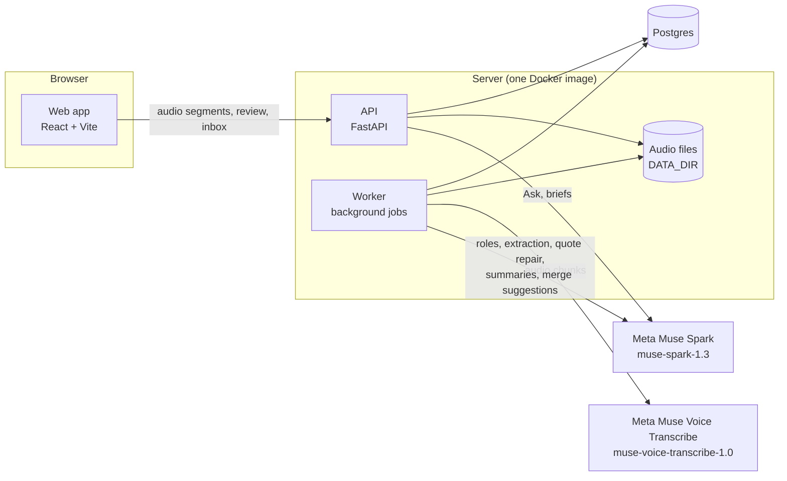

# CounterTalk

**Hear what shopkeepers tell your reps.**

Field sales reps at FMCG companies visit neighbourhood shops all day, and what shopkeepers tell them gets lost: late credit notes, short deliveries, competitor offers, requests for new products. CounterTalk records the visit and turns it into routed work:

1. **It transcribes the conversation,** in Hindi, English, Hinglish or Marathi, and tells the speakers apart.
2. **It pulls out each finding,** backed by the shopkeeper's exact words. Every quote is checked against the transcript, and tapping ▶ plays that moment of the recording.
3. **It sends each finding to the team that can act on it,** such as finance, distribution or trade marketing. The team works it in its inbox, and when it's fixed, the rep sees the line to pass on at the next visit.

**The AI features, in brief** (Meta models only; details [below](#meta-models-and-where-each-is-used)):
- **Transcription with speaker separation:** Muse Voice Transcribe (`muse-voice-transcribe-1.0`), biased towards the visit's languages and given the company's brand names.
- **Muse Spark (`muse-spark-1.3`):**
  - **speaker roles:** which voice is the rep and which the shopkeeper;
  - **extraction:** each finding with its category, severity, products, suggested team and the shopkeeper's quotes;
  - **quote repair,** when a quote doesn't match the transcript;
  - **issue merge suggestions,** for problems that share a cause;
  - **summaries:** each team's and the whole org's, by week or month;
  - **Ask:** a question in Hindi, Marathi or English, turned into the inbox's filters;
  - **pre-visit briefs:** where a shop stands before the next visit.
- **The AI suggests, code decides:** every answer comes back in a strict schema, and code checks the quotes, product links, citations and filters before anything is shown.

Built and tried for FMCG. The same playbook fits other goods sold through neighbourhood shops (groceries, general merchandise and apparel), because its issue categories and routing are generic to selling through shops: a new business needs only its own **org pack**, the data files with its catalog, teams and routing, and no code changes. Pharma and agri products would need some tuning of the playbook (their issue categories and rules) in future. Creating a company's org, shops and users is still script work today ([Known limits](#known-limits)).

> All code in this repository was written during the Meta AI Developer Hackathon (27 Oct – 4 Nov 2026). Research and planning were done before it.
>
> The deadline was 4 Nov, 9 PM ET, which is 7:30 AM on 5 Nov in India, so the last commits carry 5 Nov dates in IST.

## Try the demo

- **Live app:** _link to be added_.
- **On your own machine:** follow [INSTALL.md](INSTALL.md) and load the demo data.

Every account's password is `metahackathon`.

| Account | Role | What you'll see |
|---|---|---|
| `rep@example.com` | Field sales rep | Visits in Hindi, Hinglish and English |
| `rep2@example.com` | Field sales rep | Visits in English and Marathi |
| `rep3@example.com` | Field sales rep | Visits in English only |
| `admin@example.com` | Admin | Everything a manager sees, plus the catalog |
| `manager@example.com` | Manager | Every team's issues, summaries, Ask and briefs |
| `finance-member@example.com` | Team member (Finance) | The Finance team's inbox |
| `sales-ops-member@example.com` | Team member (Sales operations) | The Sales operations inbox |
| `distribution-member@example.com` | Team member (Distribution) | The Distribution team's inbox |

## This is demo data

- **PepsiCo India is example data.** Its brand and product names are public product information, as sold in India. PepsiCo is not a customer or partner of CounterTalk, and none of this data comes from it. There are no logos.
- **Everything else is made up:** the distributors, shops, people, schemes and conversations. The recordings are scripted role-plays voiced with generated voices.
- **It's loaded from [`demo/`](demo/)** by `backend/scripts/load_demo_data.py` (see [INSTALL.md](INSTALL.md)).

## Running it for your own company: what you need

- **An org pack** in `backend/org_packs/<id>/v1/`, with no code changes:
  - your brands and products (`skus.csv`) and your competitors (`competitors.csv`);
  - your schemes (`schemes.csv`) and distributors (`distributors.csv`);
  - your teams, what each handles, and the routing from each kind of finding to a team (`org_pack.yaml`), plus the languages your visits are in.

  Check it with `scripts/check_pack.py`, and load it into an org with `scripts/import_org_pack.py`. [`pepsico-india-demo`](backend/org_packs/pepsico-india-demo/v1/) is a complete example.
- **Your org, shops and users,** created by scripts today. `scripts/seed_dev.py` creates the demo org and its shops (to use it for another company, edit its constants), `scripts/add_user.py` adds a user, and `scripts/set_password.py` sets a password. There are no screens for these yet (see [Known limits](#known-limits)).
- **A Meta API key** (`MODEL_API_KEY`), for Muse Voice Transcribe and Muse Spark.
- **No recordings up front.** They build up as reps record or upload visits, and the inboxes, summaries, briefs and Ask fill in as visits are confirmed.

## How it works

1. **Consent first.** Before recording at a shop, the shopkeeper agrees through a consent link the rep shares, or on a paper form the rep marks. A refusal blocks recording at that shop, and the server enforces it.
2. **Record or upload.** The rep records the visit in the browser, which sends the audio in segments while it records, or uploads a recording made with another app.
3. **Transcribe.** A background worker converts the audio with ffmpeg, splits long visits into chunks, and sends them to Muse Voice Transcribe with speaker separation. Speech-to-text is biased towards the org's languages and given its brand names as keywords.
4. **Speaker roles.** Muse Spark decides which voice is the rep and which is the shopkeeper.
5. **Extract.** Muse Spark returns the findings in a strict JSON schema built from the shared playbook and the org pack. Each finding has a kind, category and severity, the products, competitors or schemes it's about, a suggested team, and the shopkeeper's quotes.
6. **Check in code.** Each quote is matched against the transcript (exactly, or fuzzily within a set score) and replaced with the transcript's own text. A finding with no matching quote is marked unverified: it's never routed, and it's left out when the visit is confirmed. Products and competitors are linked to the org's catalog through its aliases, and schemes to the pack's schemes; a name that matches nothing, or more than one item, goes to review instead of a guess. Routing combines the org pack's routing table with the model's suggestion.
7. **The rep reviews and confirms.** The rep can edit, add or remove findings, and plays each quote with ▶. Nothing reaches a team before the rep confirms.
8. **Teams work issues.** Confirmed findings group into issues by likely cause, across shops and reps. Each issue gets a due date from its severity. A team member takes it on, sets its status and, as its owner, can move the due date; resolving it needs a note for the shop. That note appears on the rep's **Fixed since the last visit** list.
9. **Over time:**
   - **Updates:** what got fixed, told back to the rep. For each shop, the problems fixed since anyone last visited it, each with the team's note to pass on ("Tell them: …"); the rep's own problems from this month that were fixed before that visit follow under a plain "Fixed". The rep's count for the month comes first: how many of the problems they raised are fixed. A shop's pre-visit brief also lists what was fixed since its last visit. No AI: the notes are the teams' own words.
   - **Summaries,** for each team and for the whole org, by week or month. The numbers come from SQL; Muse Spark writes the words, and code drops any sentence that cites nothing it was given or quotes a number that isn't in the summary.
   - **Ask:** a manager, admin or team member types a question in Hindi, Marathi or English. Muse Spark turns it into the inbox's filters, and code checks them and runs the query; the model never writes SQL.
   - **Briefs:** before a visit, a short brief of where a shop stands, once it has two confirmed visits. Code picks the facts, and Muse Spark writes the words when someone asks for it.

## Meta models, and where each is used

One Meta key (`MODEL_API_KEY`) covers both. It never leaves the server.

| Model | ID in the code | Used for |
|---|---|---|
| **Muse Voice Transcribe** | `muse-voice-transcribe-1.0` ([`stt/meta.py`](backend/countertalk/stt/meta.py)) | Transcribing every visit, with speaker separation (`DIARIZATION` mode), a language bias and catalog keywords |
| **Muse Spark** | `muse-spark-1.3` ([`llm/client.py`](backend/countertalk/llm/client.py)) | Speaker roles; extraction; repairing a quote that didn't match; summary narratives; issue merge suggestions; Ask; pre-visit briefs |

Every Muse Spark call, failed ones too, is recorded with its purpose and token counts, so its cost is known, but never with its prompt or answer. Speech-to-text's billed seconds are counted on each visit.

## Architecture

- **Backend:** Python 3.12, FastAPI, SQLAlchemy 2, Alembic and Postgres 17. The worker takes its jobs (transcribe, extract, summary, retention) from a Postgres table, so there's no extra queue to run.
- **Web:** React 19, React Router, Tailwind CSS 4 and Vite, served by the same FastAPI app.
- **Access:** sign-in with argon2-hashed passwords and an HTTP-only session cookie. Every API route on org data checks one access module's role rules first, every lookup is scoped to the user's org (another org's data is a 404), and audio is served only through an endpoint that checks access.
- **The AI suggests, code decides:** the models' answers come back in strict schemas, and code checks them (quotes, links, citations, filters) before anything is shown or stored as fact.
- **Repository:** [`backend/`](backend/) (the API, worker, migrations, org packs, playbook, eval cases, tests), [`web/`](web/) (the app and the landing page), [`demo/`](demo/) (the demo data) and the [`Dockerfile`](Dockerfile).

## Quality: transcripts and evals

These numbers come from role-plays: scripted shop visits voiced with generated voices, each with an answer key. **There are no English extraction cases,** so there are no extraction numbers for English conversations.

**Speech-to-text** (Muse Voice Transcribe, Hinglish role-plays, before any tuning):

| Recording | Speech on the right speaker | Hindi word recall | Number words | Brands found |
|---|---|---|---|---|
| rp01, with a language bias | 99.8% of 163 s | 88.1% | 26/26 | 12/13 |
| rp01, without | 99.6% of 164 s | 87.1% | 25/26 | 13/13 |
| rp06, with background noise | 98.8% of 164 s | 86.4% | 23/23 | 10/10 |
| rp09, recorded in Chrome, 2 chunks | 99.1% of 665 s | 86.2% | 96/96 | 41/45 |

English words in Hinglish speech come back in Devanagari almost every time (कोल्ड ड्रिंक, क्रेडिट नोट), so the catalog's aliases include Devanagari spellings.

**Extraction** (the full extract job: Muse Spark, then quote checks, linking and routing in code), on 22 cases: 16 Hinglish and 6 Marathi, run on 3 Nov 2026, before the catalog grew on 5 Nov. Seven cases were held back: they were scored once and never used to change a prompt.

| | Tuning set: 15 cases, 3 runs | Held-back set: 7 cases, 1 run |
|---|---|---|
| Findings found (recall) | 38/38 in every run | 20/20 |
| Findings that were expected (precision) | 38/39 in every run | 20/20 |
| Findings in the 2 visits with nothing to find | 0 | (no such case) |
| Category agrees with the key | 37–38 of 39 | 19 of 21 |
| Severity agrees | 33–35 of 39 | 20 of 21 |
| Routed to the expected team | 37–38 of 39 | 19 of 21 |
| Quotes matched to the transcript | all (71–77 exact, 1–2 fuzzy a run) | all (32 exact, 2 fuzzy) |

The agreement rows count the matched findings, including one optional finding in each set's key. The three Marathi tuning cases agreed with their keys on everything, in every run. The misses are mostly judgement calls on severity; the one unexpected finding in each tuning run was a finding split in two, or an extra one.

**Ask:** 9 questions (4 in English, one of them off-topic and expected to be refused; 3 in Hindi; 2 in Marathi), each with its expected filters: **9 of 9 right.**

**Patterns over time:** a six-week world of 30 shops with planted patterns. Tests check that the issue counts, labels and ranks come out as the kit says. In the first paid run, the one planted duplicate issue wasn't suggested for merging. After a change to the merge prompt made for that miss, the second run suggested it (1 of 1, with no wrong suggestions) and kept 27 of 28 narrative sentences: the one dropped quoted a number that wasn't in the summary. One planted case is evidence, not proof.

The extraction and Ask cases are in [`backend/evals/`](backend/evals/), and the pattern kit is in [`backend/tests/fixtures/patterns/`](backend/tests/fixtures/patterns/). `backend/scripts/run_eval.py` runs all three (`--ask`, `--patterns`).

## Known limits

- **No English extraction eval** (above). English visits work and are in the demo, but there are no measured numbers for them.
- **No screens for creating orgs, shops or users.** It's done with scripts today: `seed_dev.py` for an org and its shops, and `add_user.py` and `set_password.py` for users. `add_user.py` accepts only example.com addresses, as a guard while all users are made up.
- **No native phone app,** and no live coaching during the visit. Recording is in the browser, or by uploading a file.
- **Speech-to-text quirks:** English words in Hindi speech usually come back in Devanagari, and it sometimes doubles a word ("all all"). Quotes keep what was transcribed.
- **Consent:** a consent link or a paper form, with refusals enforced. The consent text hasn't had a legal review.
- **Retention:** audio is deleted a set number of days after its visit is confirmed (`AUDIO_RETENTION_DAYS`, 30 by default). Transcripts and quotes stay.
- **Not yet built for paying customers:** row-level security in Postgres, a full audit log of who viewed what (changes are already recorded), encrypted object storage, and hosting in an Indian region.
